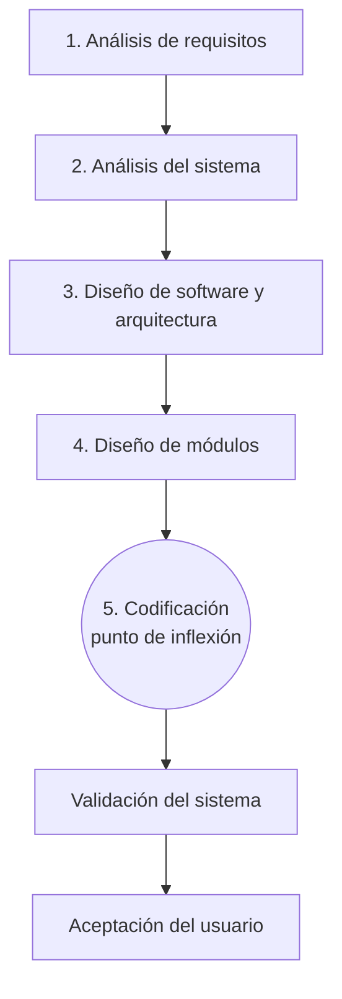
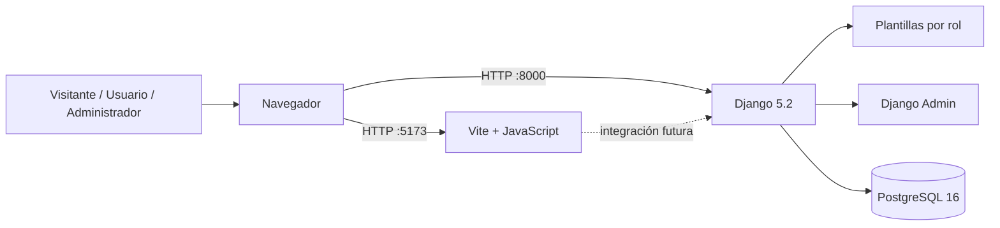
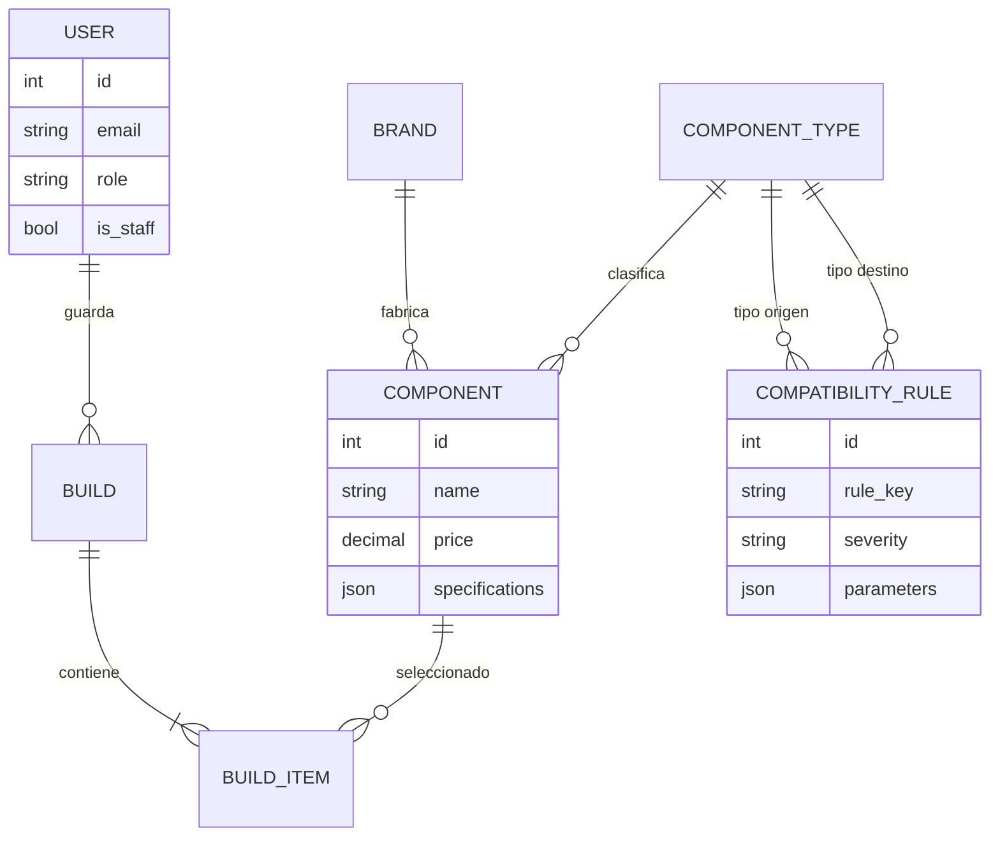

# Simulador de Armado y Compatibilidad de PC

Aplicación web para armar una configuración de PC componente por componente y validar en tiempo real la compatibilidad entre las piezas: socket CPU/placa, tipo de RAM, potencia de la fuente, formato de placa/gabinete, longitud de la GPU y cuellos de botella, entre otras reglas. El sistema calcula el costo total, estima el consumo energético y muestra alertas visuales explicando cada conflicto.

> **Estado de esta entrega:** documentación de la metodología en V y esqueleto funcional del backend Django (autenticación, roles, catálogo, builds demo y Django Admin). La creación y edición de builds desde la interfaz pública, el motor de reglas, el catálogo completo y la exportación PDF/enlace quedan documentados como roadmap.

---

## 1. Descripción del proyecto

El objetivo es resolver un problema frecuente al comprar, armar o actualizar una PC: la incertidumbre técnica y el miedo a gastar dinero en piezas incompatibles. La herramienta traduce especificaciones técnicas dispersas en decisiones claras y visuales.

- **Público objetivo:** armadores primerizos, usuarios que actualizan componentes, gamers con presupuesto ajustado, estudiantes y técnicos.
- **Contexto:** interfaz en español y catálogo pensado para componentes disponibles en la región.
- **Valor diferencial:** validación automática de compatibilidad, alertas por colores, costo y consumo en vivo, builds compartibles.

---

## 2. Metodología de Desarrollo en V

La metodología en V separa el proyecto en una **rama descendente de verificación** (qué debe hacer el sistema y cómo se diseñará) y una **rama ascendente de validación y aceptación**. Esta entrega cubre la rama descendente y el punto de inflexión hacia la codificación.



### 2.1 Análisis de requisitos

**Actores del sistema (según `idea.txt`):**

| Actor | Descripción |
|---|---|
| Visitante | Usuario no registrado. Explora el catálogo, arma una build temporal, ve validaciones y costo, y puede exportar el resultado. |
| Usuario registrado | Además de lo anterior, guarda, nombra, edita, compara y consulta el historial de sus builds. |
| Administrador | Mantiene el catálogo, las especificaciones, las reglas de compatibilidad y gestiona a los usuarios. |

> La propuesta del sistema define tres actores. Por eso no se implementa un rol «Gestor» separado: las tareas de mantenimiento del catálogo recaen en el Administrador.

**Requisitos funcionales:**

| Código | Requisito |
|---|---|
| RF-01 | Mostrar un catálogo de componentes filtrable por tipo, marca y precio. |
| RF-02 | Permitir armar una build temporal sin registro (sesión de visitante). |
| RF-03 | Validar compatibilidad en tiempo real y explicar cada conflicto. |
| RF-04 | Clasificar resultados con alertas verde (compatible), amarilla (advertencia) y roja (incompatible). |
| RF-05 | Calcular el costo total y el consumo energético estimado frente a la fuente. |
| RF-06 | Detectar cuellos de botella entre CPU y GPU según su gama. |
| RF-07 | Guardar, editar, comparar y consultar el historial de builds (usuario registrado). |
| RF-08 | Exportar la build como PDF o enlace compartible. |
| RF-09 | Gestionar componentes, reglas de compatibilidad y usuarios desde el panel administrativo. |
| RF-10 | Registro, inicio y cierre de sesión con vistas diferenciadas por rol. |

**Requisitos no funcionales:**

- Interfaz en español, responsive, accesible y con tema claro/oscuro persistente.
- Seguridad: contraseñas con validadores de Django, CSRF, sesiones y permisos por rol.
- Portabilidad: todo el entorno se ejecuta con Docker Compose.
- Mantenibilidad: apps Django separadas por dominio y código comentado.
- Rendimiento: validaciones en tiempo real sin recargar la página (fase frontend).
- Persistencia: PostgreSQL 16.

### 2.2 Análisis del sistema

Flujo principal de uso:

1. El usuario entra al catálogo y elige un tipo de componente.
2. Agrega piezas a la build; el sistema registra la selección.
3. El motor de reglas evalúa las combinaciones y devuelve alertas con severidad y motivo.
4. Se recalculan costo total y consumo estimado.
5. El usuario guarda la build (si está registrado) o la exporta.
6. El Administrador mantiene el catálogo y las reglas que alimentan el motor.

**Reglas de compatibilidad previstas:**

- Socket del procesador contra socket de la placa madre.
- Tipo de memoria (DDR4/DDR5) contra ranuras de la placa.
- Potencia de la fuente contra consumo estimado + margen de seguridad.
- Formato de placa (ATX, micro-ATX, mini-ITX) contra formato del gabinete.
- Longitud de la GPU contra espacio disponible del gabinete.
- Generación de CPU contra chipset de la placa.
- Alertas de cuello de botella según gama de CPU y GPU.

**Estados de validación:** `compatible` (verde), `advertencia` (amarillo) e `incompatible` (rojo). Cada resultado incluye el motivo y una recomendación.

### 2.3 Diseño de software y arquitectura

**Stack tecnológico:**

| Capa | Tecnología |
|---|---|
| Backend | Python 3.12 + Django 5.2 LTS |
| Base de datos | PostgreSQL 16 |
| Frontend | Vite 8 + JavaScript vanilla (scaffold listo, integración pendiente) |
| Contenedores | Docker + Docker Compose |
| Administración | Django Admin |
| Configuración | django-environ + variables de entorno |

**Arquitectura actual:**



El backend sirve las vistas y plantillas con Django, aplica autenticación y permisos por rol y expone el Django Admin. El frontend Vite se levanta de forma independiente mediante un perfil de Docker y se integrará en una fase posterior. La base de datos vive en su propio contenedor con volumen persistente.

**Decisiones de diseño:**

- Modelo de usuario personalizado desde el inicio (`AUTH_USER_MODEL`) para incorporar el rol sin migraciones destructivas.
- Login por correo electrónico mediante un backend de autenticación propio.
- Separación por apps de dominio: cuentas, catálogo, builds y núcleo.
- El motor de reglas se modela como datos (`CompatibilityRule`) para poder administrarlo sin recompilar.

### 2.4 Diseño de módulos

| App | Responsabilidad |
|---|---|
| `accounts` | Usuario personalizado, roles, registro, login y logout. |
| `catalog` | Marcas, tipos de componente, componentes y reglas de compatibilidad. |
| `builds` | Configuraciones guardadas y sus componentes. |
| `core` | Inicio, catálogo público, paneles por rol y control de acceso. |

**Modelo de datos:**



**Flujo de autenticación y roles:**

1. El visitante navega sin cuenta y accede al catálogo público.
2. El registro crea un usuario con rol `USUARIO` y sin permisos de staff.
3. El login por email redirige al panel correspondiente al rol.
4. El Administrador (`role=ADMIN` + `is_staff`) accede al panel administrativo y al Django Admin.
5. Un usuario autenticado sin permisos recibe `403` al intentar entrar a un panel ajeno.

### 2.5 Punto de inflexión y codificación

El punto de inflexión es la codificación: se materializa el diseño anterior en el esqueleto del proyecto. En esta entrega se implementan:

- Entorno reproducible con Docker Compose y PostgreSQL.
- Proyecto Django con apps separadas por dominio.
- Modelo de usuario con roles y autenticación por email.
- Modelos base de catálogo, reglas y builds.
- Django Admin configurado.
- Vistas y plantillas diferenciadas para Visitante, Usuario y Administrador.

Las funcionalidades del simulador (motor de reglas, validaciones en vivo, PDF y enlaces compartibles) corresponden a la siguiente iteración.

---

## 3. Roles y permisos

| Acción | Visitante | Usuario registrado | Administrador |
|---|:---:|:---:|:---:|
| Ver catálogo público | Sí | Sí | Sí |
| Armar build temporal | Sí | Sí | Sí |
| Ver validaciones y costo | Sí | Sí | Sí |
| Guardar/editar builds | No | Sí | Sí |
| Comparar builds guardadas | No | Sí | Sí |
| Gestionar catálogo y reglas | No | No | Sí |
| Gestionar usuarios | No | No | Sí |
| Acceder al Django Admin | No | No | Sí |

> La tabla describe el alcance objetivo del sistema. En esta entrega, la creación y edición de builds desde la interfaz pública todavía no está implementada: solo se consultan builds demo y se administran desde Django Admin.

El visitante se representa con `AnonymousUser`: no tiene fila en la base de datos y obtiene acceso solo a las vistas públicas.

---

## 4. Estructura del repositorio

```text
simulador-pc/
├── README.md
├── docker-compose.yml
├── .env.example
├── .gitignore
├── backend/
│   ├── Dockerfile
│   ├── .dockerignore
│   ├── entrypoint.sh
│   ├── manage.py
│   ├── requirements.txt
│   ├── config/              # settings, urls, wsgi/asgi
│   ├── apps/
│   │   ├── accounts/        # usuario, roles, auth
│   │   ├── catalog/         # componentes y reglas
│   │   ├── builds/          # builds e ítems
│   │   └── core/            # inicio, catálogo, paneles
│   ├── templates/
│   └── static/
└── frontend/
    ├── Dockerfile
    ├── .dockerignore
    ├── index.html
    ├── package.json
    ├── vite.config.js
    └── src/
```

---

## 5. Puesta en marcha

### 5.1 Requisitos previos

- Docker Desktop con Docker Compose.
- Node.js 20.19+ o 22.12+ (solo si se trabaja el frontend fuera de Docker).
- Puerto 8000 libre para Django y 5173 para Vite.

### 5.2 Configurar variables de entorno

```powershell
Copy-Item .env.example .env
```

Edita `.env` y define una contraseña segura para PostgreSQL y una `DJANGO_SECRET_KEY` propia. El archivo `.env` no debe versionarse.

### 5.3 Levantar el backend y la base de datos

```powershell
docker compose build
docker compose up -d db
docker compose run --rm web python manage.py migrate
docker compose run --rm web python manage.py createsuperuser
docker compose up
```

Servicios disponibles:

- Aplicación: <http://localhost:8000/>
- Login: <http://localhost:8000/accounts/login/>
- Registro: <http://localhost:8000/accounts/register/>
- Django Admin: <http://localhost:8000/admin/>

### 5.4 Cargar datos de ejemplo

El comando es idempotente y no elimina información existente:

```powershell
docker compose exec web python manage.py seed_demo_data
```

Carga 8 tipos de componente, 12 marcas, 29 componentes, 8 reglas de compatibilidad y 2 builds. También crea el usuario demo:

- Correo: `demo@example.com`
- Contraseña: `Demo12345!`
- Rol: Usuario registrado

Las builds demo se muestran en modo de solo lectura; la creación y edición desde la interfaz se habilitará en próximas entregas. El stock es referencial: se muestra en el catálogo, pero no descuenta unidades ni bloquea piezas. Las reglas quedan cargadas para la siguiente fase: el motor todavía no las evalúa. Si el usuario demo ya existe, el comando no cambia su contraseña.

### 5.5 Levantar el frontend Vite (opcional)

El servicio está desactivado por defecto mediante el perfil `frontend`:

```powershell
docker compose --profile frontend up --build frontend
```

Vite queda disponible en <http://localhost:5173/>. Todavía no consume datos del backend; la integración se hará en la siguiente fase.

---

## 6. Comandos útiles

```powershell
# Ver estado de los contenedores
docker compose ps

# Ver logs del backend o de la base de datos
docker compose logs -f web
docker compose logs -f db

# Crear migraciones después de cambiar modelos
docker compose run --rm web python manage.py makemigrations

# Abrir una consola de Django
docker compose run --rm web python manage.py shell

# Cargar catálogo, reglas y builds de ejemplo
docker compose exec web python manage.py seed_demo_data

# Acceder a PostgreSQL
docker compose exec db psql -U simulador -d simulador_pc

# Detener los servicios (conserva los datos)
docker compose down
```

---

## 7. Roadmap

1. Catálogo de ejemplo cargado; ampliar hacia un catálogo real de componentes.
2. Motor de reglas de compatibilidad y cálculo de consumo.
3. Build temporal en sesión para visitantes.
4. Comparación de builds guardadas.
5. Exportación a PDF y enlace compartible.
6. Integración del frontend Vite con la API de Django.
7. Compartir builds públicamente y permitir que tanto el autor como otros usuarios dejen opiniones o críticas sobre ellas.

---

## 8. Cumplimiento de las condiciones de la actividad

| Condición | Estado |
|---|---|
| B.1 Stack Python, Django, Vite y Docker | Completo |
| B.2 Entorno virtual de desarrollo con Docker | Completo |
| B.4 Django y librerías instaladas | Completo |
| B.5 Backend estructurado por necesidades del proyecto | Completo |
| B.6 App de registro e inicio de sesión | Completo |
| B.7 Django Admin configurado | Completo |
| B.8 Vistas y plantillas por rol | Completo |
